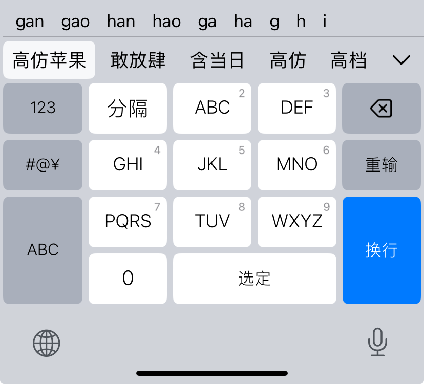

# T9-TWO

基于元书内置 T9 键盘（作者 Morse）修改的九键皮肤。
整体参考 iOS 17.6 原生九键布局，并针对日常输入做了调整。
---

## 与官方原始 T9 的主要区别

### 一、中文九键布局

原始 T9：
- 左侧是一列纵向符号/拼音
- 右侧是退格、重输、0、换行
- 底部是 #+=、123、空格、中英、换行
- 拼音候选和候选词没有现在这种上下分层

T9-TWO：
- 左列：123、#@¥、ABC（ABC 跨最后两行）
- 中列：1-9 九个数字键，底部 0 和空格
- 右列：退格、重输、确认（确认跨最后两行）
- 顶部改为「拼音候选栏在上、候选词在下」的横向布局
- 拼音栏较窄、候选词栏较高（上窄下宽），贴近 iOS
- 拼音栏与候选词栏之间有一条较淡的分割线，常态下也显示，并与候选词色块留有小间距
- 拼音字号 20，词组间距加宽，接近 iOS 原生
- 1 键常态点击输入中文「，」，上滑输入中文「。」；打字时自动显示「分隔」
- 0 键为预编辑输入，按空格/选定后才上屏
- 空格键在预编辑时显示「选定」，点击上屏候选
- 按键圆角改为 6，更接近 iOS 17.6
- 四行按键高度按苹果键盘比例调整，确认键等跨行按键同步加高
- 浅色模式采用苹果键盘配色：灰底、深灰系统键、白色字母键
- 浅色/深色、竖屏/横屏均已适配

### 二、英文 26 键

原始 T9 的英文键盘保留数字切换键和中英切换图标。

T9-TWO：
- 符号切换键标识改为 #@¥（九键、26 键、数字键盘统一）
- 底行：拼音 / #@¥ / 空格 / . / 回车
- 移除数字键盘切换键
- 点号与中英切换位置互换，最终点号在空格右侧
- j 键上滑输入 '，右上角提示为 '
- x 键上滑输入 ~，右上角提示为 ~
- 底部逗号键改为点号键，不再保留英文逗号

## 使用说明

1. 需要元书 1.6.0 或更高版本。
2. 输入方案请选择「中文九键」（万象九键(元书) 或雾凇），否则九键只会输入数字。
3. 展开全部候选时，顶部保留预编辑拼音行；元书的展开候选区不会刷新 T9 拼音词组列表，所以不会显示那一排拼音词组。
4. 确认键绑定回车（enter），在不同 App 中的行为可能不同。

## 文件结构

- demo.png：预览图
- config.yaml：皮肤配置
- light/：浅色键盘配置
- dark/：深色键盘配置
- jsonnet/：Jsonnet 源码
